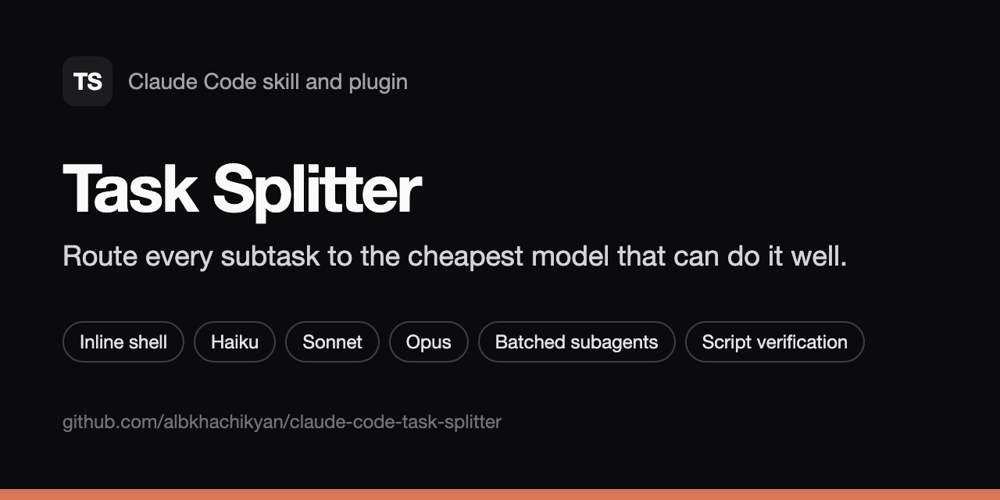

# Task Splitter: a Claude Code skill that routes each subtask to the cheapest capable model

**Task Splitter is a Claude Code skill and plugin that lowers the model cost of building
features.** It splits a task into atomic subtasks and scores how hard each one is. Each
subtask then goes to the cheapest tier that can do it well: inline shell, Haiku, Sonnet or
Opus. Subtasks that share a model and effort level are batched into one subagent, so each
subagent's startup context is paid once. Results are verified with your own tests and
linters, and only a subtask that fails is escalated.



```text
/plugin install task-splitter --marketplace albkhachikyan/claude-code-task-splitter
```

## At a glance

|               |                                                                                                                   |
| ------------- | ----------------------------------------------------------------------------------------------------------------- |
| What it is    | A Claude Code skill, packaged as a plugin, for cost-aware task planning and execution                             |
| Who it is for | Developers who use Claude Code to build products and features, and want lower token spend without lower quality   |
| Main idea     | Use the cheapest model and effort that can do each piece of work, and pay subagent startup context once per batch |
| Model tiers   | T0 inline shell, T1 Haiku/low, T2 Sonnet/medium, T3 Sonnet/high, T4 Opus/high                                     |
| Works best in | Plan mode (Shift+Tab), for multi-step features                                                                    |
| Invoke        | `/task-splitter:task-splitter <task>` (plugin) or `/task-splitter <task>` (manual install)                        |
| Requires      | Claude Code 2.1.275 or later for the one-step plugin install; any recent version for the manual install           |
| License       | MIT                                                                                                               |
| Version       | 1.0.0                                                                                                             |

## Contents

- [Install](#install)
- [Usage](#usage)
- [How it works](#how-it-works)
- [Model tiers](#model-tiers)
- [Where the savings come from](#where-the-savings-come-from)
- [Task Splitter compared with other approaches](#task-splitter-compared-with-other-approaches)
- [FAQ](#faq)
- [Configuration](#configuration)
- [Files](#files)
- [Related](#related)

## Install

### As a plugin (recommended)

In Claude Code:

```text
/plugin install task-splitter --marketplace albkhachikyan/claude-code-task-splitter
```

On versions before 2.1.275, use two steps:

```text
/plugin marketplace add albkhachikyan/claude-code-task-splitter
/plugin install task-splitter@albkhachikyan-task-splitter
```

The skill is then available as `/task-splitter:task-splitter`. To update it, run
`/plugin marketplace update albkhachikyan-task-splitter`.

### Manually, as a personal skill

```bash
git clone https://github.com/albkhachikyan/claude-code-task-splitter.git
cd claude-code-task-splitter && ./install.sh
```

`install.sh` symlinks the repository to `~/.claude/skills/task-splitter`, so `git pull`
updates the skill. It is safe to run more than once, and it never overwrites a real folder.
Start a new session, then run `/task-splitter`.

## Usage

Switch to plan mode (Shift+Tab), then describe the task:

```text
/task-splitter Add dark mode: theme store with persistence, a toggle in the header, and tests
```

You get three tables:

1. **Split.** Subtasks with an id, goal, files, dependencies, done-check and type.
2. **Routing.** A 0–10 difficulty score per subtask and the tier it maps to.
3. **Cost preview.** Batches per wave, with estimated cost units compared with an
   all-Opus baseline.

Approve the plan. The skill then runs each wave and launches its batches in parallel. It
checks every result with your project's own commands, escalates only the subtasks that fail,
and reports the outcome in ten lines or fewer.

To resume an interrupted task, run the skill again in the same project. The task ledger in
`.claude/task-splitter/` records where it stopped.

## How it works

```text
main task ─► capture to a ledger ─► light scout ─► split into atomic subtasks
          ─► score (5 dimensions) ─► route to a tier ─► batch by (model, effort, wave, code area)
          ─► cost preview, approved by you ─► run waves in parallel ─► verify with scripts
          ─► escalate failures one tier, once ─► log the outcome to calibrate future routing
```

1. **Capture.** The task is restated in ten lines or fewer (goal, constraints, acceptance
   criteria, out of scope) and saved to
   `<project>/.claude/task-splitter/<date>-<slug>.md`, so the work can be resumed later.
2. **Scout.** It reads only what the split needs. A broad search goes to a single Haiku
   `Explore` agent that returns paths and one-line findings.
3. **Split.** Each subtask can be finished by one agent without making decisions that belong
   to another subtask. Design decisions are pulled out into their own early subtask, so the
   later ones are mechanical and cheap.
4. **Score.** Five dimensions, each 0 to 2: ambiguity, reasoning depth, blast radius,
   context needed and novelty. Override rules apply on top; for example, auth, payments and
   data migrations never go below T3.
5. **Batch.** Dependency waves come first. Within a wave, subtasks are grouped by
   `(model, effort)` and then by code area. A batch holds at most six subtasks, and no file
   is edited by two batches in the same wave.
6. **Execute.** All batches of a wave start in one message. Every batch brief begins with
   the same byte-identical preamble, which makes prompt caching effective.
7. **Verify.** The main thread runs tests, lint, typecheck and the build. No model call is
   spent reviewing what a script can check.
8. **Escalate.** A failing subtask moves up exactly one tier, once, with the failure output
   attached. If it still fails, the skill stops and asks you.
9. **Learn.** One line per subtask is appended to `~/.claude/task-splitter/routing-log.md`.
   Task types that keep failing start one tier higher next time, and types that keep passing
   can drop a tier.

## Model tiers

| Tier | Score | Runs as                   | Typical work                                                                            |
| ---- | ----- | ------------------------- | --------------------------------------------------------------------------------------- |
| T0   | 0     | main thread, inline shell | install dependencies, create folders, rename, set a config value                        |
| T1   | 1–3   | Haiku, low effort         | boilerplate that follows an existing pattern, copy edits, fixtures, docs                |
| T2   | 4–6   | Sonnet, medium effort     | normal feature code, components, endpoints, tests that follow existing patterns         |
| T3   | 7–8   | Sonnet, high effort       | multi-file logic, state management, integrations, tricky bugs, auth, payments, security |
| T4   | 9–10  | Opus, high effort         | architecture, data model, cross-cutting design, hard debugging, performance             |

## Where the savings come from

There are three levers, and all of them appear in the cost preview before anything runs:

- **Cheaper models for easy work.** The preview uses relative weights of Haiku 1, Sonnet 3
  and Opus 5, multiplied by effort (low 1, medium 1.5, high 2.5). Mechanical work, which is
  usually most of a feature, never touches Opus.
- **No agent for deterministic steps.** `pnpm add`, `mkdir` and renames run as shell
  commands. Starting a subagent costs more than the command itself.
- **Fewer cold starts.** Each subagent loads its own context. Batching same-tier subtasks
  from the same code area into one agent pays that context once.

Illustration, using the skill's own weights (an example, not a measurement): a feature with
two T0 steps, two T1 subtasks, one T2 and one T4 comes to about 19 cost units. The same six
subtasks all on Opus with high effort come to about 75 units. Real savings depend on the
task mix. Measure them with your actual usage.

## Task Splitter compared with other approaches

|                                          | Everything on Opus | `/model opusplan`           | Task Splitter                                 |
| ---------------------------------------- | ------------------ | --------------------------- | --------------------------------------------- |
| Model per subtask                        | one model          | Opus plans, Sonnet executes | chosen per subtask, from inline shell to Opus |
| Haiku for mechanical work                | no                 | no                          | yes                                           |
| Shell steps without a model              | no                 | no                          | yes (T0)                                      |
| Batching to reduce subagent startup cost | no                 | no                          | yes                                           |
| Cost preview before execution            | no                 | no                          | yes, with an all-Opus baseline                |
| Verification                             | model review       | model review                | your tests, lint and typecheck                |
| Escalation on failure                    | none               | none                        | one tier, once, only for the failing subtask  |
| Resumable plan on disk                   | no                 | no                          | yes, a ledger per task                        |

They can be combined: run the main session on `opusplan` and let Task Splitter route the
subagents.

## FAQ

### How do I reduce Claude Code token costs?

Give each piece of work to the smallest model that can do it, keep deterministic steps out of
model calls, and avoid starting many subagents that each reload the same context. Task
Splitter automates all three. On top of that, keep stable project rules in `CLAUDE.md` so
prompts stay short and cache well.

### What is a Claude Code skill?

A skill is a folder with a `SKILL.md` file of instructions that Claude Code loads when your
request matches its description, or when you invoke it by name. A plugin packages one or more
skills so they can be installed from a marketplace.

### Does it work outside plan mode?

Yes. Outside plan mode it shows the split and the cost preview, and waits for your approval
before it runs anything. Plan mode is recommended because the plan and the approval step are
built in.

### When should I not use it?

For small tasks. If the whole task scores 3 or less, or has two subtasks or fewer, the skill
says so and simply does the work, because splitting would cost more than it saves.

### Does it lower quality?

Quality is protected in three ways. Hard rules keep risky work at T3 or above. Every result
is checked by your own tests and linters. A subtask that fails is retried one tier higher.

### Which models does it use?

Haiku, Sonnet and Opus, through the Agent tool's `model` and `effort` parameters. It never
uses forked agents for cheap tiers, because a fork always runs on the parent model.

### How do I change the tiers?

Edit the tier table in `SKILL.md` and the rubric in `references/routing-rubric.md`. The
routing log then calibrates the tiers to your own projects over time.

### Where is my data stored?

Task ledgers are stored in your project at `.claude/task-splitter/`. Commit them or add them to
`.gitignore`, as you prefer. The routing log is in your home folder,
`~/.claude/task-splitter/`. Nothing is sent anywhere.

## Configuration

| What                                              | Where                                |
| ------------------------------------------------- | ------------------------------------ |
| Tier table and hard rules                         | `SKILL.md`                           |
| Scoring dimensions, overrides, worked examples    | `references/routing-rubric.md`       |
| Prompt skeleton and reply format for batch agents | `references/batch-brief-template.md` |
| Task ledger format                                | `templates/split-ledger.md`          |

## Files

```text
SKILL.md                            workflow and hard rules (loaded by Claude Code)
references/routing-rubric.md        scoring, overrides, worked examples, calibration
references/batch-brief-template.md  prompt skeleton and reply format for batch agents
templates/split-ledger.md           format of the saved task ledger
.claude-plugin/plugin.json          plugin manifest
.claude-plugin/marketplace.json     single-plugin marketplace
install.sh                          manual install (symlink into ~/.claude/skills)
llms.txt                            summary for AI assistants and crawlers
```

## Related

- [Next.js Frontend Foundation](https://github.com/albkhachikyan/nextjs-frontend-foundation):
  a Claude Code skill that scaffolds strict, production-ready Next.js 16 frontends. Task
  Splitter treats its scaffold scripts as free T0 steps.

## Contributing

Issues and pull requests are welcome. If you propose a change to the tier defaults, include
lines from your routing log that show the change helps.

## License

[MIT](LICENSE) © 2026 Albert Khachikyan
